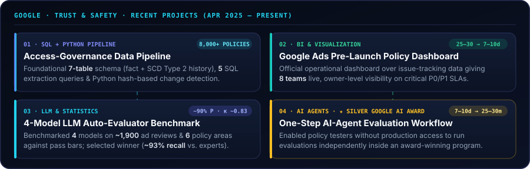

<!-- Custom Animated Telemetry Header Card -->

  

<!-- Quick Action Navigation -->

  
  
  
  
  

 

<!-- Toolkit Icons -->
<h3 align="center">Analytical Toolkit</h3>

  

  
  
  
  
  
  

 

<!-- Google Trust & Safety Recent Projects Showcase -->
<h3 align="center">Recent Projects @ Google (Trust &amp; Safety)</h3>

  

 

<!-- Visual 2x2 Featured Repositories Grid -->
<h3 align="center">Public Analytics Repositories</h3>

  
  

  
  

 

<!-- Live Contribution Telemetry -->
<h3 align="center">GitHub Telemetry</h3>

  

  
  &nbsp;
  

